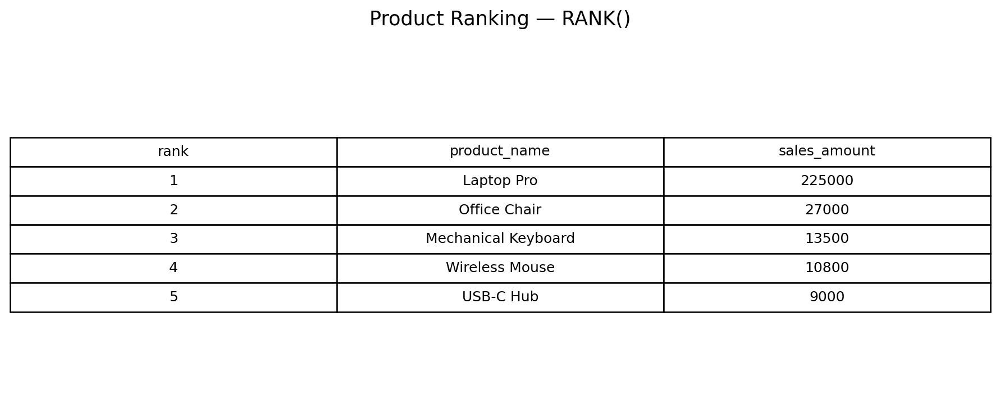
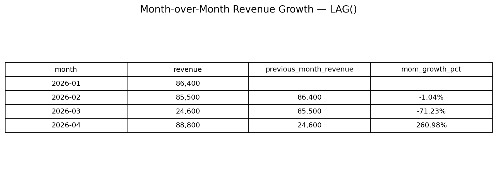
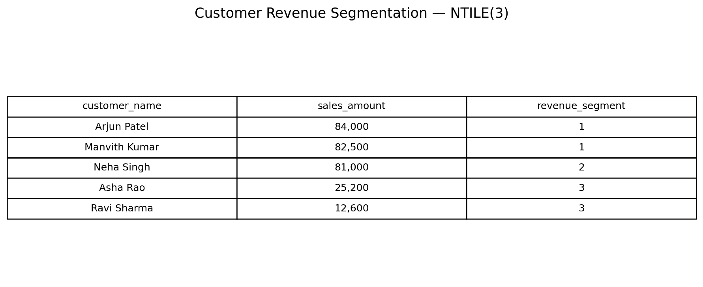
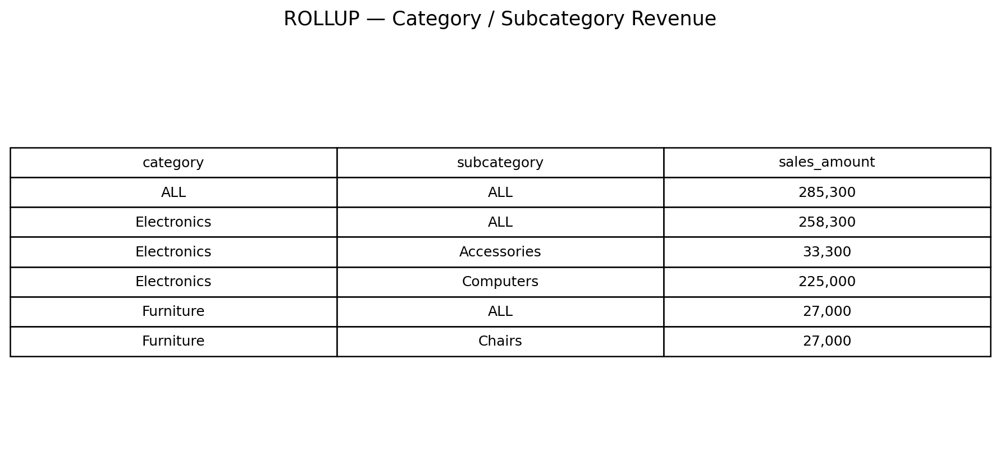

# DataGrokr PLP — Week 5: SQL Dimensional Report

## Objective

This project implements the Week 5 DataGrokr PLP mini project:

> **Dimensional model + window function report + CTE MoM growth**

The project is designed around PostgreSQL and demonstrates the Week 5 topics listed in the supplied DataGrokr PLP material: scalar/correlated subqueries, `EXISTS` / `NOT EXISTS`, normalization concepts, window functions, CTEs, set operations, `ROLLUP`, `CUBE`, `GROUPING SETS`, views and query-plan analysis.

## Project structure

```text
week5_sql_dimensional_report/
├── schema.sql
├── seed_data.sql
├── queries.sql
├── README.md
└── outputs/
    ├── 01_product_ranking.png
    ├── 02_mom_growth.png
    ├── 03_customer_segments.png
    └── 04_rollup_summary.png
```

## Tech stack

- PostgreSQL 15+
- SQL
- Git / GitHub

## Data model

The project uses a small **star schema**:

```text
             dim_customer
                  |
                  |
dim_date ---- fact_sales ---- dim_product
```

### Fact table

`fact_sales` stores measurable business events:

- order_id
- date_key
- customer_key
- product_key
- quantity
- sales_amount

### Dimension tables

- `dim_customer` — customer descriptive attributes
- `dim_product` — product/category attributes
- `dim_date` — calendar attributes

This separation makes analytical queries easier to extend and is a standard dimensional-modelling pattern.

## What is demonstrated

### 1. Subqueries

- Scalar subquery
- Correlated-style aggregation comparison
- `EXISTS`
- `NOT EXISTS`

### 2. Window functions

- `RANK()`
- `DENSE_RANK()`
- `LAG()`
- `LEAD()`
- `NTILE()`
- Window frame with cumulative `SUM()`

### 3. CTEs

The monthly revenue CTE is reused to calculate:

- previous-month revenue
- revenue change
- month-over-month growth percentage

### 4. Set operations

- `UNION`
- `INTERSECT`
- `EXCEPT`

### 5. Advanced aggregation

- `ROLLUP`
- `CUBE`
- `GROUPING SETS`

### 6. Reporting objects and optimization

- Standard view
- Materialized view
- `EXPLAIN ANALYZE`
- Composite indexes

## Generated output screenshots

### Product ranking using RANK()



### Month-over-month growth using LAG()



### Customer segmentation using NTILE()



### ROLLUP business summary



## Expected key results

The seeded dataset intentionally contains:

- a product (`Monitor Stand`) with no sales
- customers with different revenue levels
- multiple months so that `LAG()` and MoM growth are meaningful
- multiple categories/subcategories so `ROLLUP`, `CUBE` and `GROUPING SETS` produce useful summaries

### Monthly revenue

| Month | Revenue |
|---|---:|
| 2026-01 | 86,400 |
| 2026-02 | 85,500 |
| 2026-03 | 24,600 |
| 2026-04 | 88,800 |

### MoM growth

| Month | Revenue | MoM growth |
|---|---:|---:|
| 2026-01 | 86,400 | NULL |
| 2026-02 | 85,500 | -1.04% |
| 2026-03 | 24,600 | -71.23% |
| 2026-04 | 88,800 | 260.98% |

## How to run

### Option A — PostgreSQL installed locally

Open **CMD** inside this project folder.

#### 1. Check PostgreSQL

```cmd
psql --version
```

#### 2. Create a database

```cmd
psql -U postgres -c "CREATE DATABASE datagrokr_week5;"
```

If the database already exists, PostgreSQL will report that it exists; continue to the next step.

#### 3. Create the schema

```cmd
psql -U postgres -d datagrokr_week5 -f schema.sql
```

#### 4. Insert the seed data

```cmd
psql -U postgres -d datagrokr_week5 -f seed_data.sql
```

#### 5. Run all Week 5 queries

```cmd
psql -U postgres -d datagrokr_week5 -f queries.sql
```

#### 6. Open an interactive SQL shell

```cmd
psql -U postgres -d datagrokr_week5
```

Then:

```sql
SET search_path TO datagrokr_week5;

SELECT * FROM vw_product_performance
ORDER BY revenue DESC;
```

Exit:

```sql
\q
```

## Option B — Docker PostgreSQL

If PostgreSQL is not installed locally but Docker Desktop is installed:

```cmd
docker run --name datagrokr-postgres -e POSTGRES_PASSWORD=postgres -e POSTGRES_DB=datagrokr_week5 -p 5432:5432 -d postgres:16
```

Then:

```cmd
docker cp schema.sql datagrokr-postgres:/schema.sql
docker cp seed_data.sql datagrokr-postgres:/seed_data.sql
docker cp queries.sql datagrokr-postgres:/queries.sql
```

Run:

```cmd
docker exec -it datagrokr-postgres psql -U postgres -d datagrokr_week5 -f /schema.sql
docker exec -it datagrokr-postgres psql -U postgres -d datagrokr_week5 -f /seed_data.sql
docker exec -it datagrokr-postgres psql -U postgres -d datagrokr_week5 -f /queries.sql
```

## GitHub submission commands

From the parent folder:

```cmd
cd path	o\week5_sql_dimensional_report
```

Initialize Git if needed:

```cmd
git init
```

Check files:

```cmd
git status
```

Add:

```cmd
git add .
```

Commit:

```cmd
git commit -m "Add Week 5 SQL dimensional report"
```

Connect your GitHub repository:

```cmd
git remote add origin https://github.com/YOUR_USERNAME/YOUR_REPO.git
```

Rename branch:

```cmd
git branch -M main
```

Push:

```cmd
git push -u origin main
```

For an existing repository, use:

```cmd
git add .
git commit -m "Add Week 5 SQL dimensional report"
git push origin main
```

## Interview explanation

If asked **"What did you build in Week 5?"**, explain it like this:

> "I built a PostgreSQL analytical reporting project using a small star schema with customer, product and date dimensions around a sales fact table. I used window functions such as RANK, DENSE_RANK, LAG, LEAD and NTILE for analytical reporting. I also used CTEs to calculate month-over-month revenue growth, set operations for customer analysis, and ROLLUP, CUBE and GROUPING SETS for multi-level aggregations. Finally, I created reusable views and used EXPLAIN ANALYZE and indexes to understand query performance."

## Important submission note

The SQL is intentionally written for **PostgreSQL** because the Week 5 topics include PostgreSQL-style analytical features such as `ROLLUP`, `CUBE`, `GROUPING SETS`, `EXPLAIN ANALYZE`, and materialized views.

Do not claim that the screenshots are output from your local PostgreSQL installation until you execute the SQL locally. The screenshots included in this starter submission are generated from the fixed seed dataset for documentation/demo purposes; after your local run, replace them with your own terminal/SQL-client screenshots if your college requires proof of execution.
