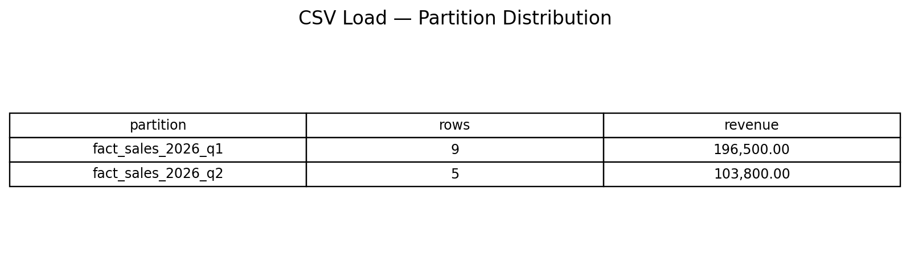
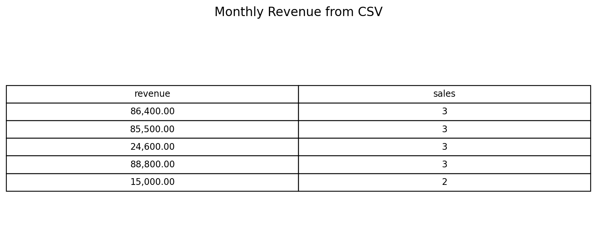
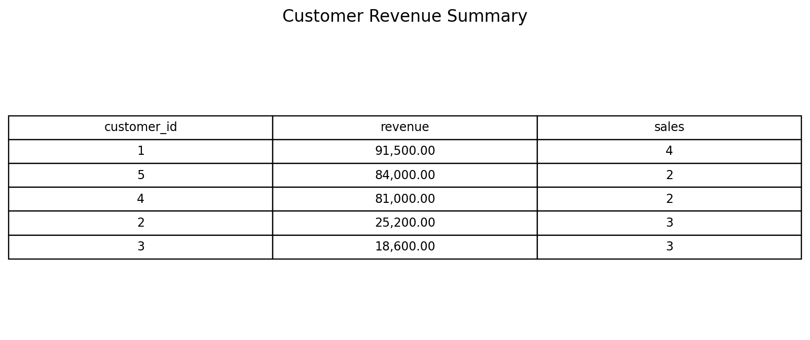

# Week 6 — Data Engineering SQL Pipeline

## Overview
This project takes a sales feed from CSV, stages it in PostgreSQL, checks the incoming records, and merges them into a date-partitioned fact table. It also includes maintenance and reporting queries that are useful around a small data pipeline.

The Week 6 topics covered are DML, `MERGE`/UPSERT, range partitioning, bulk loading with `COPY`, query-plan inspection, indexes, transactions, SCD Type 2, and JSON queries.

## Files
```text
week6_sql_de_pipeline/
├── schema.sql
├── seed_data.sql
├── sales_input.csv
├── load.sql
├── queries.sql
├── README.md
├── .gitignore
└── outputs/
    ├── 01_partition_load_summary.png
    ├── 02_monthly_revenue.png
    └── 03_customer_revenue.png
```

## Data model
- `dim_customer`: customer details plus `valid_from`, `valid_to`, and `is_current` for SCD Type 2 history.
- `dim_product`: product lookup data.
- `fact_sales`: sales records partitioned by `sale_date`.
- `stg_sales`: temporary landing table for the CSV.
- `etl_audit`: records pipeline actions.

The fact table has quarterly partitions for Q1 and Q2 2026 and a default partition for other dates. Its primary key includes `sale_date`, which is required for a unique key on a PostgreSQL range-partitioned table.

## Run locally (PostgreSQL 15+)
Open CMD in this project directory and check that `psql` is available:
```cmd
psql --version
```

Create the database (skip if it already exists):
```cmd
psql -U postgres -c "CREATE DATABASE datagrokr_week6;"
```

Create tables:
```cmd
psql -U postgres -d datagrokr_week6 -f schema.sql
```

Insert the initial dimension data:
```cmd
psql -U postgres -d datagrokr_week6 -f seed_data.sql
```

Load the CSV and merge into the fact table. Run this from the project directory so `sales_input.csv` can be found:
```cmd
psql -U postgres -d datagrokr_week6 -f load.sql
```

Run the exercises and reports:
```cmd
psql -U postgres -d datagrokr_week6 -f queries.sql
```

Save terminal output if you want to keep execution evidence:
```cmd
psql -U postgres -d datagrokr_week6 -f load.sql -o load_output.txt
psql -U postgres -d datagrokr_week6 -f queries.sql -o query_output.txt
```

## Verify the load
```sql
SET search_path TO datagrokr_week6;
SELECT COUNT(*) FROM fact_sales;
SELECT tableoid::regclass AS partition_name,COUNT(*) AS rows_loaded
FROM fact_sales GROUP BY tableoid ORDER BY partition_name;
SELECT * FROM etl_audit ORDER BY event_time DESC;
```
A clean first load should place 14 rows in `fact_sales`. Re-running `load.sql` updates matching `(sale_id, sale_date)` records rather than adding duplicates.

## Result previews
The images below are generated from the included CSV data. Run the SQL locally and compare the results; if your instructor requires execution proof, replace these previews with screenshots from your own PostgreSQL session.

### Partition load summary


### Monthly revenue


### Customer revenue


## Notes
- `MERGE` requires PostgreSQL 15 or later.
- `\copy` is a `psql` command, not plain SQL in every database GUI. Running `load.sql` with `psql -f` is the intended method.
- `EXPLAIN ANALYZE` executes the query. The plan varies with data volume, PostgreSQL version, statistics, and indexes.
- The transaction example ends with `ROLLBACK`, so the sample price change is not saved.
- The SCD Type 2 block is a demonstration. Reset the schema before replaying the entire project if you want to repeat the walkthrough from a clean state.

## GitHub submission
If this folder is inside your existing PLP repository:
```cmd
git add week6_sql_de_pipeline
git commit -m "Add Week 6 SQL data engineering pipeline"
git push origin main
```

For a new repository, create an empty GitHub repository first, then run these commands from this folder:
```cmd
git init
git add .
git commit -m "Add Week 6 SQL data engineering pipeline"
git branch -M main
git remote add origin https://github.com/YOUR_USERNAME/YOUR_REPO.git
git push -u origin main
```
Replace the example URL with your repository URL.

## Project summary
The pipeline loads a CSV sales feed into staging, runs basic quality checks, and uses `MERGE` to insert or update rows in a partitioned fact table. The supporting SQL demonstrates upserts, SCD Type 2 history, transaction control, JSON output, indexes, and query-plan inspection.
